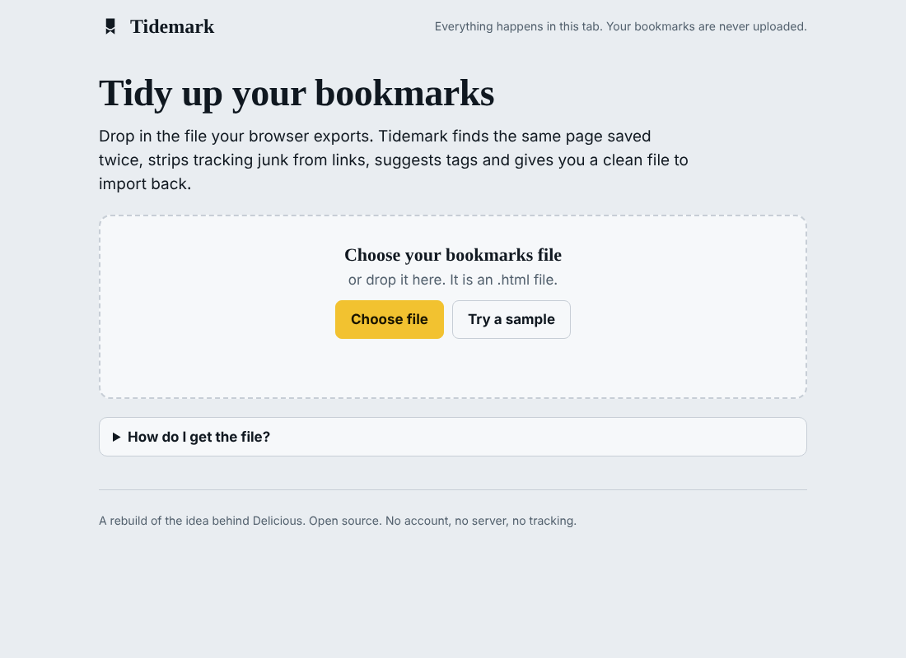
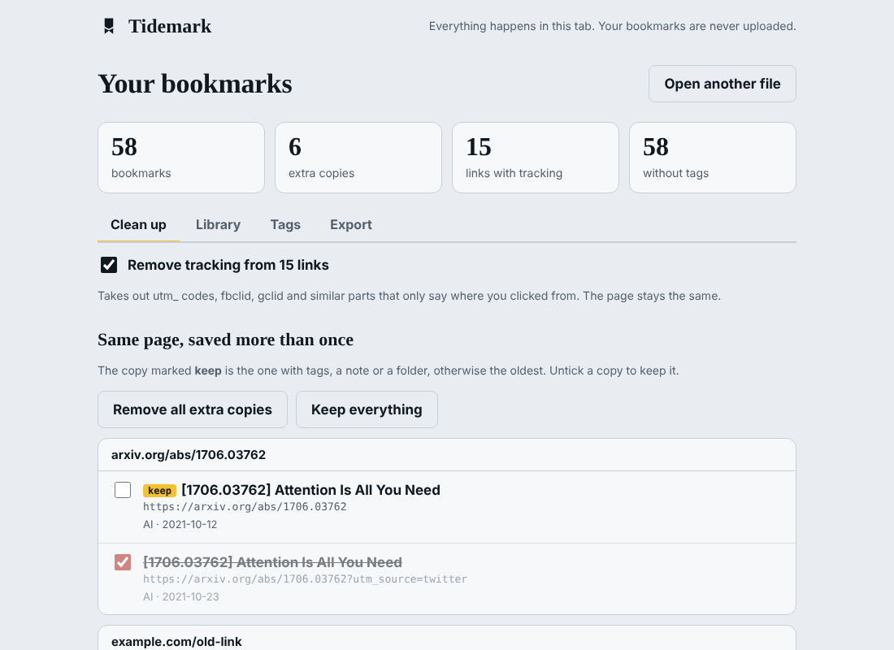
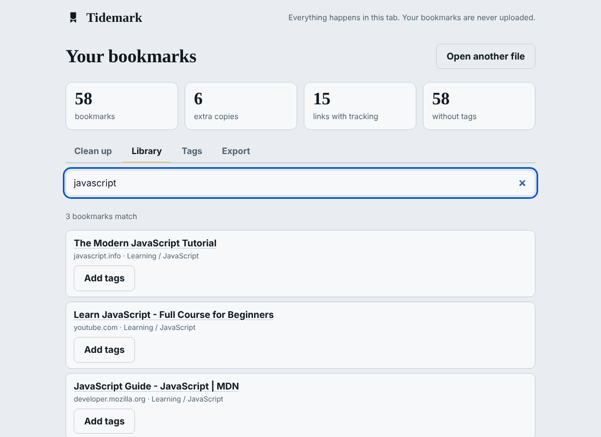
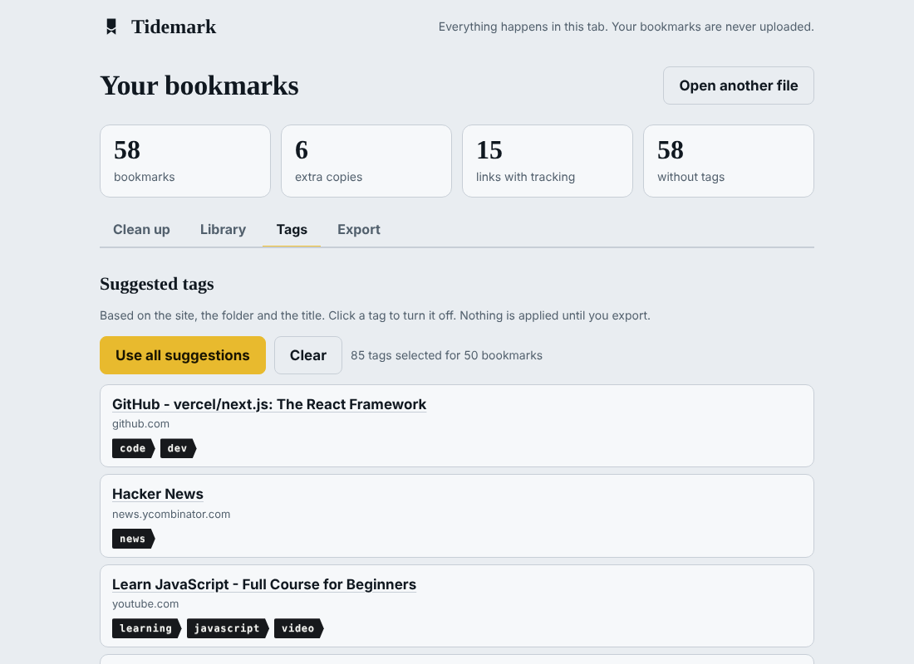
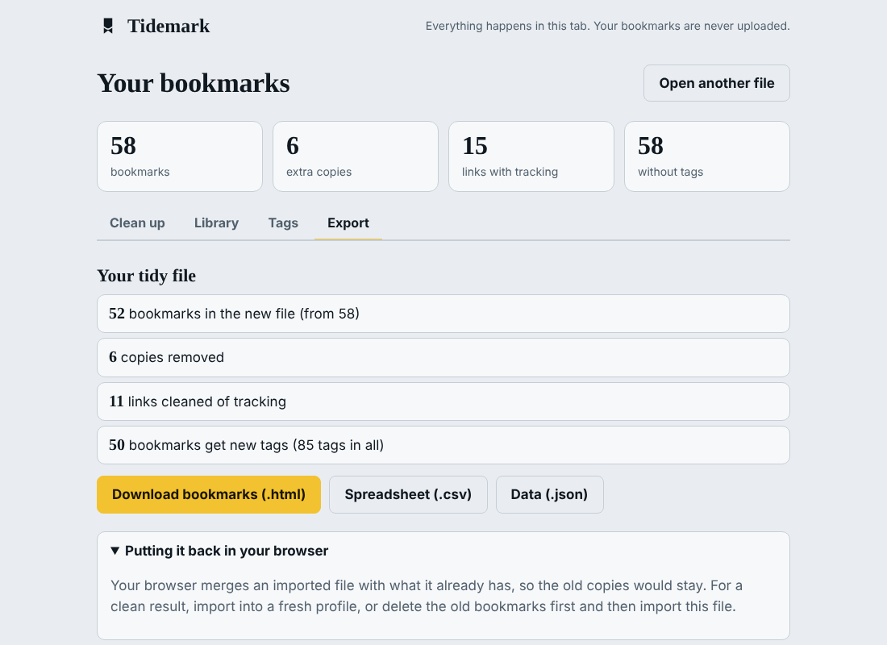

# Tidemark

Clean up your browser bookmarks. Drop in the file your browser exports and Tidemark shows you the pages you saved twice, strips tracking junk from links, suggests tags, lets you search, and gives you a tidy file to import back.

**Everything runs in your browser. Your bookmarks are never uploaded.** There is no account, no server and no tracking, and the page's security policy blocks all network requests (`connect-src 'none'`).



## What it does

- **Finds duplicates.** The same page saved in different shapes counts as one: `www` or not, `http` or `https`, a trailing slash, parameters in a different order, and YouTube short links (`youtu.be/...`) against full links. The copy that has tags, a note or a folder is the one marked **keep**.
- **Removes tracking.** Takes out `utm_*`, `fbclid`, `gclid`, `msclkid`, `mc_cid`, `igshid`, YouTube's `si` and `feature`, Twitter/X share codes and similar parts. The page stays the same. Useful parameters such as `?ref=main` or `?id=2` are left alone.
- **Flags "possibly the same".** Same site and same title but different addresses. These are never removed unless you tick them.
- **Suggests tags.** From the site (`github.com` becomes `code`), the folder name and words in the title. Plain rules, no AI. You can turn any tag off, and nothing is applied until you export.
- **Searches.** `tag:code`, `site:github.com`, `folder:work`, `-word` and `"exact phrase"` all work.
- **Exports.** A bookmarks `.html` that imports into Chrome, Edge, Firefox, Safari and Brave, plus `.csv` and `.json`.

| Clean up | Library |
|---|---|
|  |  |
| **Tags** | **Export** |
|  |  |

## Using it

1. Export your bookmarks from the browser (Chrome, Edge and Brave: bookmark manager, three dots, Export bookmarks. Firefox: Import and Backup, Export Bookmarks to HTML. Safari: File, Export, Bookmarks).
2. Open the site and choose the file, or press **Try a sample**.
3. Review the tabs, then download the new file from **Export**.
4. Import it into a fresh browser profile, or delete your old bookmarks first. Browsers merge imported files with what they already have, so the old copies would otherwise stay.

## The idea behind it

Delicious was an early bookmarking site built on tags. It changed hands several times and faded. People still have thousands of messy bookmarks and almost no tools to tidy them. Tidemark does the tidying locally, so there is nothing to host, nothing to sell, and nothing that can shut down.

## Under the hood

No dependencies and no build step beyond copying files. The bookmark file reader is written by hand (no `DOMParser`), so the same code runs in the browser and in the tests.

```
engine/parse.js    reads the Netscape bookmark format (folders, dates, tags, notes)
engine/url.js      link cleaning and the "same page" key
engine/dupes.js    duplicate and similar-page groups, and which copy to keep
engine/tags.js     tag suggestions
engine/search.js   search with operators
engine/export.js   HTML, CSV and JSON output (CSV is protected against spreadsheet formulas)
web/               the page
tests/             node:test suite, including a 20,000-bookmark speed check
```

```
npm test        # runs the tests
npm run serve   # builds and serves at http://localhost:8080
```

## Privacy

The page loads no outside scripts, fonts or images, makes no network requests, and keeps your bookmarks only in memory while the tab is open. Closing the tab clears everything.

MIT licensed.
